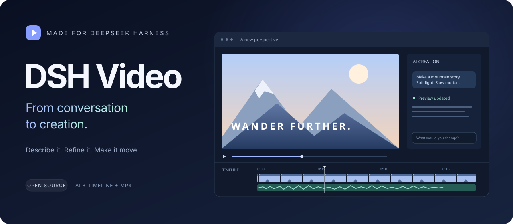

<div align="center">



# DSH Video

**Start with a conversation. Refine on a timeline. Make it move.**

An AI video workspace inside DeepSeek Harness.<br>
Create and refine in chat, preview alongside it, edit across tracks, and export to MP4.

[](docs/STATUS.md) [](https://github.com/deepseek-ai/deepseek-harness) [](https://nodejs.org/) [](#installation) [](LICENSE)

[简体中文](README.md) · **English**

[Features](#from-an-idea-to-a-video) · [Installation](#installation) · [Quick start](#quick-start) · [Development](#development) · [Docs](docs/README.md)

</div>

## From an idea to a video

| Step | What you can do |
|---|---|
| **Create in chat** | Describe a video using DSH's native conversation and models. Keep refining the same project. |
| **Preview as you go** | Automatically refresh the preview, play, pause, and seek. |
| **Edit across tracks** | Import images, video, and audio; move, trim, split, duplicate, reorder, and snap clips. |
| **See your sound** | Inspect real waveforms and continuous thumbnails. Detach video audio into its own track. |
| **Keep your progress** | Share undo/redo between AI and manual edits. Projects persist across restarts. |
| **Export a finished video** | Render H264/AAC MP4 with progress and cancellation. |

The cover is a workflow illustration. See [current status](docs/STATUS.md) for verification boundaries.

## Installation

Requires **DeepSeek Harness ≥ 0.2.1-rc.2, Node.js ≥ 22, FFmpeg/ffprobe, and Google Chrome**. Tested on macOS Apple Silicon; other platforms have not completed acceptance testing.

Open DSH **Plugins → Add plugin**, enter one of the following sources, install, and enable:

### GitHub repository

```text
https://github.com/heswy/dsh-video-editor
```

> Installation support is currently in a PR. The address above will include the complete changes once merged into main; the older main has not passed this installation path.

Plain JavaScript and engine sources ship in the repository. DSH installs dependencies; no plugin build script approval is needed. Pin a verified commit for a stable installation: `github:heswy/dsh-video-editor#<commit>`.

### npm package

```text
dsh-video-editor
```

> **First npm publication pending.** Use GitHub until it is published. `dsh-video` belongs to another author. Choose the official npm registry, or wait for your mirror to synchronize.

### Release / offline package

Download the appropriate `.tgz` from [Releases](https://github.com/heswy/dsh-video-editor/releases). Enter its download URL or absolute local path in Add plugin. The first public Release is still pending.

See [installation and publishing](docs/releases/UPDATE-CHANNEL.md) for channel details.

## Quick start

1. Open **Vedio Editor** in the DSH sidebar (the current UI label). Create or open a project.
2. Describe the video in the right-hand conversation; the preview updates on the left.
3. Continue in chat or edit clips on the timeline. Import your own media through **素材 / Assets**.
4. Choose **Export MP4**, wait for rendering, and save your video.

Try an idea like this:

> Make a 15-second product introduction with a dark background. Use three sections for the title, key features, and closing line. Keep transitions simple.

Projects default to `~/Movies/DSH Video`. DSH manages model credentials; no model API key belongs in this repository. Locally synthesized audio does not imply human singing. Direct object editing inside the canvas is deferred.

## Updates, disabling, and rollback

Use **Plugin updates** in the editor toolbar to check versions, read notes, and install explicitly. Local linked development installs are updated by the developer. Restart DSH when prompted.

Disable the plugin in DSH's plugin page. To roll back, remove it and install the previous verified package. Keep the project data directory and the old package.

## Development

```sh
git clone https://github.com/heswy/dsh-video-editor.git
cd dsh-video-editor
npm ci --ignore-scripts
npm run check
node --test tests/*.test.mjs
```

The runtime loads JavaScript directly. `host/` owns project, session, and resource boundaries; `client.js` provides the native workspace; `packages/` contains the independent engine. Read [development rules](docs/DEVELOPMENT.md) and the [publishing guide](docs/releases/UPDATE-CHANNEL.md).

Report problems through [Issues](https://github.com/heswy/dsh-video-editor/issues) with your DSH/plugin version, device, and reproduction steps. Keep credentials and private projects out of reports. See [SECURITY](SECURITY.md) for vulnerability reports.

## Acknowledgements and license

Built for [DeepSeek Harness](https://github.com/deepseek-ai/deepseek-harness), with a video engine powered by [HyperFrames](https://github.com/heygen-com/hyperframes). Thanks to the open-source community.

[MIT](LICENSE) © DSH Video contributors
