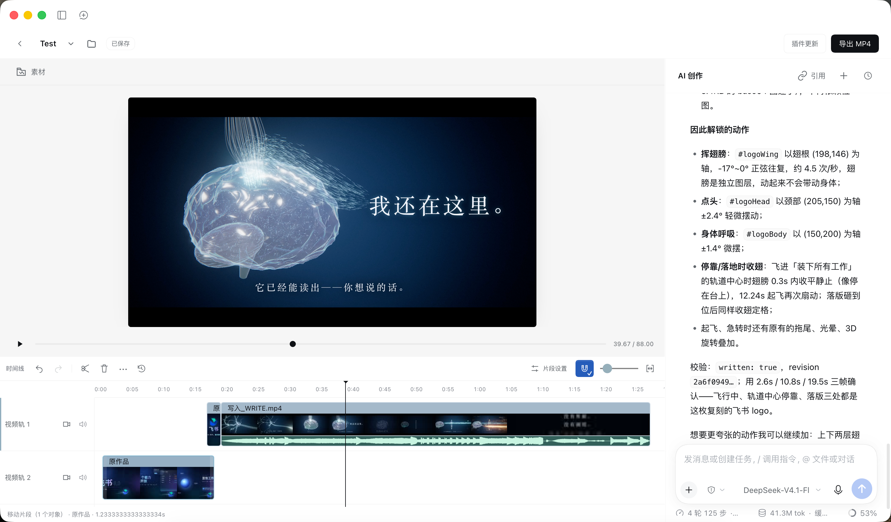

<div align="center">


# dsh-video-editor

**用对话构思，用时间线打磨，让想法成为影片。**

DeepSeek Harness 内的 AI 视频创作与剪辑工作台。<br>
右侧对话生成与续改，左侧即时预览，多轨剪辑与 MP4 导出一站完成。

[](https://www.npmjs.com/package/dsh-video-editor) [](https://github.com/deepseek-ai/deepseek-harness) [](https://nodejs.org/) [](LICENSE)

**简体中文** · [English](README.en.md)

[功能](#从一句想法到一条影片) · [安装](#安装) · [开始创作](#开始创作) · [开发](#开发) · [文档](docs/README.md)

</div>



## 从一句想法，到一条影片

| 创作环节 | 你可以做什么 |
|---|---|
| **对话创作** | 描述想要的影片，复用 DSH 的模型和原生对话，持续修改同一作品。 |
| **即时预览** | 自动更新画面，播放、暂停、跳转，边看边调整。 |
| **多轨剪辑** | 导入图片、视频与音频；移动、裁剪、拆分、复制、排序和吸附。 |
| **看见声音** | 真实音频波形、连续视频缩略图，视频原声一键分离为独立音轨。 |
| **放心修改** | AI 与手动操作共享撤销/重做；工程自动保存，重开继续创作。 |
| **交付成片** | 导出带声音的 H264/AAC MP4，查看进度或取消任务。 |

## 安装

需要 **DeepSeek Harness ≥ 0.2.1-rc.2、Node.js ≥ 22、FFmpeg/ffprobe 和 Google Chrome**。

打开 DSH **插件 → 添加插件**，使用下列任一来源，安装后启用：

### GitHub 仓库

```text
https://github.com/heswy/dsh-video-editor
```

### npm 包名

```text
dsh-video-editor
```

npm 安装推荐选择官方源。

更多安装与更新方式见[安装指南](docs/releases/UPDATE-CHANNEL.md)。

## 开始创作

1. 从 DSH 左侧进入 **dsh-video-editor**，创建或打开作品。
2. 在右侧描述影片；生成后左侧自动更新预览。
3. 继续对话，或在时间线上调整片段。自己的图片、视频和音频从 **素材** 导入。
4. 点击 **导出 MP4**，等待完成并保存成片。

可以从这样的想法开始：

> 做一段 15 秒的产品介绍，深色背景，分三段展示标题、亮点和结束语，转场简洁。

工程自动保存到 `~/Movies/DSH Video`，模型沿用 DSH 中的配置。

## 更新、停用与回滚

点击顶栏 **插件更新** 检查并安装新版本。

在 DSH 插件页可以停用；需要回滚时，重新安装上一版本即可，工程数据独立保存。

## 开发

```sh
git clone https://github.com/heswy/dsh-video-editor.git
cd dsh-video-editor
npm ci --ignore-scripts
npm run check
node --test tests/*.test.mjs
```

运行时为直接加载的 JavaScript。`host/` 负责工程、会话与资源边界，`client.js` 提供原生工作区，`packages/` 保存独立视频引擎。开发规则见 [DEVELOPMENT](docs/DEVELOPMENT.md)，发布流程见[发行指南](docs/releases/UPDATE-CHANNEL.md)。

发现问题请提交 [Issue](https://github.com/heswy/dsh-video-editor/issues)，附 DSH/插件版本、设备及复现步骤。安全问题见 [SECURITY](SECURITY.md)。

## 致谢与许可

基于 [DeepSeek Harness](https://github.com/deepseek-ai/deepseek-harness)，视频引擎使用 [HyperFrames](https://github.com/heygen-com/hyperframes)。感谢开源社区。

[MIT](LICENSE) © dsh-video-editor contributors
