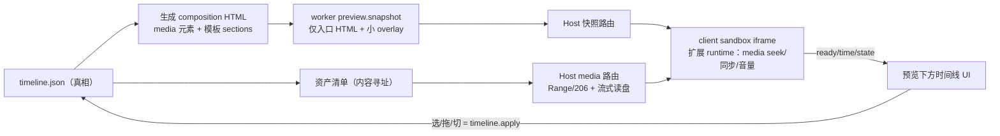
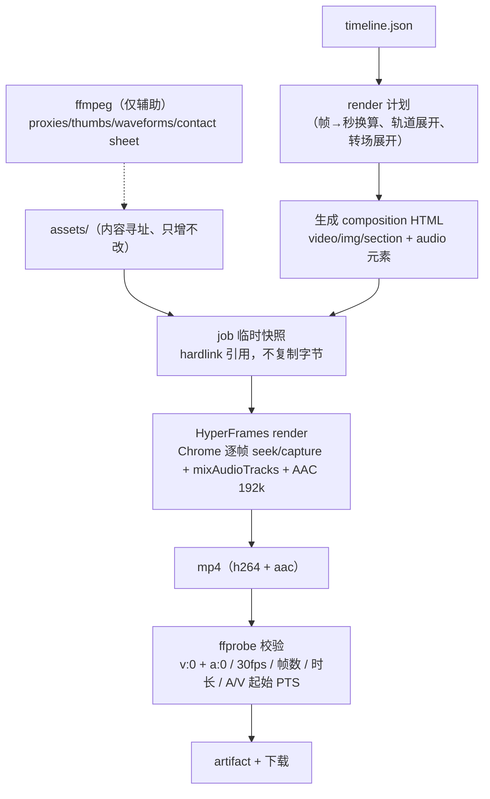

# DSH Video 时间线/轨道架构与 AI 剪辑操作协议预研

> 日期：2026-10-21（Asia/Shanghai）。基线：`origin/main` @ `9b0928e`，插件 `0.3.0-alpha.10`（engine worker/client `0.4.0`，HyperFrames/SDK `0.8.167`，GSAP `3.15.0`）。只读 worktree，只写本文件。
> 证据分级：**[仓库]** = 本仓库 `file:line`；**[实测]** = 2026-10-21 本机/已装 staging 事实（含 Lead 转来的 `0.8.167` 安装包核对）；**[外部]** = 公开文档/仓库，标注访问日期；**[推断]** = 本报告推理，未验证。
> 同批调研：`docs/research/2026-10-21-video-plugin-architecture-audit.md`（版本/持久化/UI 插入点）、`2026-10-21-audio-generation-research.md`（音频来源与成本）、`2026-10-21-baocut-and-ai-editor-landscape.md`（行业与反模式）。本文只负责**时间线数据模型、剪辑操作协议、预览/导出管线**。

## TL;DR（≤20 行）

1. 推荐架构一句话：**声明式 `timeline.json`（tracks/clips/assets + 帧为单位）是工程唯一真相；受控 HTML composition 由 timeline 单向生成，是"渲染目标"而非真相；预览与导出共用同一份生成 composition、同一个 HyperFrames 引擎（媒体元素 + 音频混流）；ffmpeg 只做校验、代理、缩略图、波形与兜底**——即任务书中的 **B 方案（timeline 为真相，composition 降级为渲染目标）**，不做 C 的双向同步。
2. 校准依据：已装 HyperFrames `0.8.167` 原生支持 `<video>/<audio>` + `data-start/data-duration/data-media-start(=in 点)/data-playback-rate(0.1–10)/data-volume`，render 侧有 `extractAudioSegment`/`mixAudioTracks`（ffmpeg `amix normalize=0` + AAC 192k）/`generateSilence`（**[实测]** Lead 2026-10-21 核对 staging engine-worker 依赖）。**不需要另起一套 ffmpeg 时间线渲染器**；真正阻塞全在插件层（§1.4 四条）。
3. 现状缺口一句话：今天的工程里**没有"片段"实体**。最接近的是 Scene（固定模板 `<section data-scene-id data-start data-duration>`）与 composition 内 `.clip` 元素，但都没有源素材、in/out、轨道、音频；长视频本身进不了工程（import 只收 PNG/JPEG，validator 禁 `<video>/<audio>`，CSP `media-src 'none'`）。
4. 稳定 ID 规则：`assetId = "as_" + sha256 前 8 hex`（内容寻址、天然去重）；`clipId = "cl_" + 10 位随机 base32`（**永不复用、永不从位置派生**）；`trackId = "tr_v1/tr_a1"`（分配序号固定）；**split 时左段保留原 clipId，右段分配新 clipId**，回执返回 `keptClipId/newClipId/lineage`。
5. 时间单位：真相层统一 **整数帧 @ 工程 fps=30（CFR，与现有引擎硬编码一致）**；源素材 in/out 存**源 fps 下的整数帧**；工具 API 同时接受秒（兼容旧习惯），入口换算、回执双写；v1 不支持 29.97/可变帧率。
6. 操作协议：**单一命令网关**——UI 手势与 AI Tool 都走 `timeline.apply`（`expectedRevision + operationId + ops[]`，默认原子批量），回执含 `affectedClipIds/createdClipIds/lineage/changeSummary/historyCursor`；错误码见 §4.3；AI 引用只认稳定 ID（`@clip:cl_x` / `@asset:as_x` / `@track:tr_v1`），「第 2 段」等位置描述一律服务端 `timeline.resolve` 解析成 ID 后再写。
7. 预览选型：**单 iframe 播放由 timeline 生成的 composition**（媒体元素由扩展后的固定 runtime 同步，音频走 composition 内 `<audio>`/HyperFrames runtime 路径）；媒体资产走**工程级稳定 asset 路由 + HTTP Range**，不进 revision 快照；音频自动播放（opaque origin）是 M0 必验项，失败兜底为预览侧 WebAudio。
8. 导出选型：**HyperFrames render 一条管线**（视频 capture + 音频 mixAudioTracks + AAC 192k 48kHz），worker 只补 ffprobe 校验（本次新增 `a:0` 校验）、代理/缩略图/波形生成；不引入浏览器端 ffmpeg.wasm / WebCodecs / 服务端 ffmpeg 时间线组装器（列 M0 兜底，不在 M1 承诺）。
9. 迁移：v0.3(`index.html` 多 Scene) 工程**惰性一次性转 v2**——每个 Scene 生成一个 `composition` clip（复用 `buildDocumentHtml` + `transplantManagedOverrides`），旧文件备份、不自动批量迁移；旧动作 `scene.*/project.compose` 在 legacy 模式继续可用，双模并存到 M3。
10. 里程碑：M0 预研验证门（媒体与音频在 0.8.167 的真实行为 + 性能基线）→ M1 timeline 内核+视频轨 → M2 音频轨+生成音频接入 → M3 素材库 → M4 @引用+AI 操作全量 → M5 持久化/文件夹+发布门禁。
11. 最大风险：① 媒体元素在 headless render 中的**逐帧 seek 性能/稳定性**（20s/120s 目标未测）；② 预览 iframe 内**音频自动播放策略**；③ 大视频资产与现有 `read()` 全量读入内存/快照复制模型冲突；④ 迁移视觉回归。四项都放进 M0 门禁，失败有明确降级路径。
12. 不做：WebCodecs/自研解码、多用户实时协同、任意 ffmpeg filter 暴露给 AI、双向 composition↔timeline 同步、完整 NLE（关键帧/蒙版/调色/多机位）。

## 1. 现状与缺口

### 1.1 现有数据模型（[仓库]）

| 实体 | 位置/形态 | 关键限制 |
|---|---|---|
| Project | 目录 + `project.json` `{entry:"index.html", assets[], title?}`，managed registry `managed/projects.json` | manifest ≤16 KiB（`projects.mjs:365`）；`entry` 必须 `index.html`（`:373-374`）；≤64 个声明资产（`:389`）；单文件 ≤64 MiB、工程 ≤128 MiB（`:406-410`），**全部 readFile 进内存** |
| revision | `sha256(JSON({entry, files:[{path,bytes,sha256}]}))`（`projects.mjs:428`） | 内容寻址、覆盖全部声明文件；任何文件变更即新 revision |
| Composition | 单个 HTML 文档，`#main[data-composition-id/data-width/data-height/data-duration]` + `window.__timelines.main`（`composition.mjs:164-179,219-247`） | **禁 `<video>/<audio>/<source>/<track>` 等媒体标签**（`composition.mjs:35-45`）；禁外部 URL（`:47`）；≤48 KiB/JSON-escape ≤60 KiB（`:22,25`）；SDK 往返校验（`:249-291`） |
| Scene | `<section data-scene-id data-start data-duration>` + 子元素（`scenes.mjs:223`），模板 `product-launch-v1` | ≤12 个、0.5–60s/个、总 ≤3600s（`scenes.mjs:6-9`）；元素只由模板字段生成 |
| 元素 stableId | HyperFrames `element.scopedId`（如 `scene-2-title`） | 用于 `edit` 的 text/timing/layout/style 四类 op（`tool.js:67-103`）；≤40 元素进 prompt（`composition.mjs:33`） |
| 资产 | `manifest.assets[]` 相对路径 + `assets/` 下文件；`asset.import` 只支持 PNG/JPEG（`asset-inbox.js:27,76`） | 无视频/音频；无时长/分辨率/音轨等媒体元数据 |
| 变更协议 | 每个动作 `projectId + expectedRevision + operationId + ops`；operationId 内存幂等表 ≤2048（`projects.mjs:1067-1085`） | 冲突即 `E_REVISION_CONFLICT`，不自动 rebase |
| 历史 | `.dsh-video/history/{entries.jsonl,ops.jsonl,state.json,snapshots/<rev>.html}`，≤64 条/8 MiB（`history.mjs:6-8`） | 快照存**整份 HTML**；undo/redo 把快照写回 `index.html`（`:201-236`）；`recordOp` 记录不可撤销的资产类操作（`:242-261`） |
| 预览 | worker `preview.snapshot` 复制 entry+全部声明资产到 `<outputRoot>/previews/<id>/`（`previews.mjs:89-187`，≤65 文件/128 MiB），Host 注册精确路由 + CSP（`snapshot.js:173-269,348-391`） | **媒体不在 MIME 表、CSP `media-src 'none'`**（`snapshot.js:39-52,376`）；整文件缓冲、**无 HTTP Range**；每 revision 复制全部资产 |
| 渲染 | `jobs.mjs` 把项目快照到临时目录 → HyperFrames CLI `render`（`--fps 30 --format mp4 --quality standard`）→ ffprobe 只校验 `v:0`（h264/30fps/帧数/时长）（`:286-305,340-388`）；frame 用 `snapshot --at`，多时刻 ffmpeg 拼 contact sheet（`:389-446`） | render 900s/frame 120s 超时（`:19-21`）；**不校验音频流**；超时对 120s 媒体工程可能不够 |
| 画布 | sandbox iframe（`sandbox="allow-scripts"`，`client.js:4112`）+ Host 注入 `canvas-runtime.js`：读 `#main[data-duration]`、按 `data-start/duration` 算可见窗口、seek GSAP（`canvas-runtime.js:16-27,125-136,241-249`） | runtime **不处理 media 元素**；子资源走 public exact webServer 路由（`snapshot.js:109-111,220-251`） |

### 1.2 数据流（当前）

`AI/UI → Host bridge.validateParams → worker(JSONL) → Projects.read()（全文件入内存）→ 动作实现（整文档 parse/regate/原子写）→ revision 重算 → recordWrite(快照) → preview.snapshot（复制+hash）→ Host 注册路由 → client iframe 播放`；`render → Projects.snapshot（复制到 job temp）→ HyperFrames CLI → ffprobe → artifact`。

### 1.3 「长视频被切成几段」在现模型里对应什么？缺口是什么？

结论：**今天没有任何一种现成实体能正确表达"源视频的片段"**。

| 候选映射 | 现状 | 为什么不够 |
|---|---|---|
| Scene | 模板生成的 `<section>`，有 `data-start/duration` | 只有标题/副标题/色块/图片字段，**不含源素材**、无 in/out、无音频；模板唯一（`scenes.mjs:4-13`） |
| composition 内 `.clip` 元素 | 元素带 `data-start/data-duration`（`scenes.mjs:193-223`） | 时间挂在 DOM 元素上，无 `sourceIn`、无轨道/z-order、无音频、无源素材引用；媒体标签被 validator 禁掉（`composition.mjs:35-45`） |
| manifest 资产 | 只有文件名清单 | 无 mediaType/时长/尺寸/帧率/音轨元数据；只接受 PNG/JPEG（`asset-inbox.js:27,76`） |
| HTML 里的 `<video>` | 被 validator 禁 + CSP 禁 + import 不支持 | 即便放开，HTML 也不是可 diff/可撤销/可被 AI 稳定引用的编辑结构 |

具体缺口清单（也是本报告要填的）：① 片段/轨道/素材三实体；② 源内 in/out 与速度；③ 多视频轨 z-order + 多音频轨混音；④ 媒体元数据与媒体资产导入/复用；⑤ 媒体播放（预览）与音频混音（导出）；⑥ 大文件资产的读取/快照/路由策略；⑦ 整文档重写模型在 ~100 clip 时不可扩展（编辑、diff、撤销、AI inspect 都变差）；⑧ 历史快照粒度（整 HTML vs 结构化 JSON）。

### 1.4 插件层的四条硬阻塞（Lead 2026-10-21 证据，作为实现约束）

| # | 阻塞 | 现状证据 | 设计对策（见 §5.4） |
|---|---|---|---|
| B1 | composition 契约明确拒绝媒体元素 | `composition.mjs:35-45`、worker README | 引入 composition **双类**：`generated`（worker 生成、允许媒体、校验 data-* 契约）vs `user`（AI/用户提交，继续禁媒体）；生成物不进用户提交面 |
| B2 | `asset.import` 只支持 PNG/JPEG，无 mp4/mp3/wav 类型 | `asset-inbox.js:27,76`、protocol schema | 新增 media asset 类型 + ffprobe 元数据 + 内容寻址存储 + 格式白名单 |
| B3 | preview snapshot 按 revision 复制并 hash 全部声明文件（≤65/128 MiB），大视频无法承受 | `previews.mjs:23-24,89-187` | 媒体资产改为**工程级稳定 asset 路由 + Range**，不进 snapshot；snapshot 只放生成的入口 HTML + 小型 overlay |
| B4 | 预览 iframe 是 opaque origin，子资源走 public exact 路由；video seek 需要 Range（现有路由整文件缓冲、无 Range） | `snapshot.js:271-346,368-381`、`client.js:4112` | 新增 media 路由：206/Range/HEAD/流式读盘、hash 注册时校验一次、ACAO/CORP 头；CSP 增 `media-src 'self'` |

## 2. 方案对比与推荐

### 2.1 三种方案

- **A：HTML composition 为唯一真相**。片段 = composition 内 `<video>/<audio>` 元素或 Scene 区段；AI/UI 直接改 composition（data-* 属性）。
- **B：声明式 timeline 为真相**（tracks/clips/assets，结构化 JSON），HTML composition 降级为**由 timeline 生成的渲染目标**；组装可由 HyperFrames（推荐）或 ffmpeg（兜底）完成。
- **C：双向混合**。timeline 描述编辑意图，composition 负责视觉包装/模板，两者双向同步。

### 2.2 对比

| 维度 | A（HTML 真相） | B（timeline 真相，推荐） | C（双向同步） |
|---|---|---|---|
| 可编辑性 | 时间语义散落在 DOM 属性/内联 style，无结构；整文档重写；跨轨道关系靠 `data-track-index` 约定 | 结构化，字段级 diff/校验/迁移；split/move/ripple 都是纯函数 | 两份真源，任何修改都要定义同步方向与冲突 |
| AI 可操作性 | AI 必须解析/重写整段 HTML，易误伤无关元素；48 KiB/40 元素上限先撞墙 | `timeline.inspect → ops[]`；小 payload、稳定 ID、原子批量、回执 lineage | 最容易出现"改了 A 没改 B"；协议复杂
| 预览实时性 | 天然同构（同一 HTML） | 生成 composition 后同构；生成是毫秒级纯函数，可缓存 | 同步开销 + 失效判断 |
| 导出质量 | 取决于 HTML 渲染 | 同一引擎输出；参数（码率/帧率/音频）可在生成器集中控制 | 需保证两目标产出等价 |
| 迁移成本 | 0（沿用现状） | 中：新 schema/生成器/ops + 旧工程转换；但复用 validator/snapshot/runtime/history 资产 | 高：先建 B 再建同步层，风险叠加 |
| 与现有引擎/工具/历史兼容 | 高 | 高——revision 公式、history 快照、expectedRevision/operationId 全部沿用，只需快照内容从 HTML 改为 timeline JSON + overlay blob | 低 |
| 复杂度 | 低起步、高天花板（规模与非结构化成本指数上升） | 中（一次建模，长期收敛） | 高 |
| 规模上限 | 48 KiB HTML、12 Scene、40 元素（很快不够）；整文档重写 O(n) | 数百 clip、多轨；JSON 分页 inspect | 不可控 |

**结论：选 B**（任务书中的 B；C 的双向同步明确不做）。A 的问题不是"HTML 不能表达媒体"（`0.8.167` 已证明能），而是"HTML 不适合当编辑真相"：无字段级 diff/撤销/引用、整文档重写、规模上限。行业侧同构证据：BaoCut 明确"video 是真相，文件只是导出"、UI/CLI/Agent 共用一个命令网关；其反模式清单把"把时间线写进 composition 当真源"列为会把下一版拖死的做法（[外部] `https://github.com/JimLiu/baocut`，2026-10-21；详见同批 BaoCut 调研）。

B 的内部再分两个变体，本报告推荐 **B-1**：

- **B-1（推荐）单一渲染管线**：timeline → 生成受控 composition（媒体元素内联，符合 `0.8.167` 契约）→ 同一文档用于预览（iframe runtime）与导出（HyperFrames render + `mixAudioTracks`）。ffmpeg 只做校验/代理/缩略图/波形。
- **B-2（兜底，不在 M1 承诺）独立时间线渲染器**：composition 只逐 clip 烘焙，主时间线由 ffmpeg `trim/concat/xfade/overlay` 组装 + 自建音频图。理由是 `0.8.167` 已具备媒体 seek 与混音，B-2 是重复造轮子；仅在 M0 实测媒体逐帧 seek 不可接受（性能/稳定性）时启用，且数据模型/ops 不变，只换渲染适配层。

### 2.3 明确"不做什么"

1. **不做 C 的双向同步**（composition 只许生成，不许反向解析成真相）。
2. **不把 HTML 当编辑真相**，也不让 AI 直接对生成 composition 做 `edit ops`（旧 `edit` 动作仅用于 legacy 工程）。
3. **不建独立 ffmpeg 时间线组装器**（B-2 仅兜底）；不做浏览器端 ffmpeg.wasm 导出；v1 不做 WebCodecs 自研解码/合成。
4. **不做**多用户实时协同、关键帧/蒙版/调色/多机位/变速曲线、字幕轨、转场库（v1 仅 crossfade）。
5. **不自动批量迁移**用户旧工程；不做"位置式引用"契约（「第 2 段」必须 resolve 成 ID）。

## 3. 推荐数据模型

### 3.1 工程目录：真相层 vs 派生层

```
<projectDir>/
  project.json          # manifest v2：{schema, entry:"timeline.json", title, assets[]}
  timeline.json         # ★唯一真相：settings/assets/tracks/clips/transitions
  assets/<sha8>.<ext>   # 内容寻址媒体资产（只增不改；同内容去重）
  overlays/<sha>.html   # （可选，M4）自定义 HTML 视觉 blob；内容寻址、≤48 KiB
  index.html            # legacy-only（v0.3 工程保留，v2 不再写）
  .dsh-video/
    history/            # 沿用：entries/ops/state + snapshots/<rev>/timeline.json
    legacy/             # 迁移前备份（index.html + project.json），回滚用
    cache/              # ★派生，不进 revision：proxies/、thumbs/、waveforms/、baked/
```

- **真相** = `timeline.json` + `assets/`（内容 hash）+ `overlays/`；`project.json` 只是小 manifest（≤16 KiB 沿用）。
- **派生** = 生成的 composition HTML、代理、缩略图、波形、烘焙片段：可删除可重建，不进 revision、不进历史。
- revision v2 = `sha256(JSON({schema:"dsh-video/project@2", files:[{path,bytes,sha256} sorted]}))`，`files` 只含真相文件；与现状 `projects.mjs:428` 公式同构，`expectedRevision` 语义不变。

### 3.2 编辑态 vs 渲染态（Lead 要求显式区分）

| 编辑态（timeline，可被 AI/UI 操作） | 渲染态（generated composition，只读派生） |
|---|---|
| `asset{assetId,kind,path,sha256,durationFrames,fps,width,height,hasAudio}` | 不出现；媒体 `src` 用工程内相对声明路径 `<sha8>.<ext>` |
| clip(kind=media) `startFrame/durationFrames/sourceInFrame/speed` | `<video class="clip" data-start data-duration data-media-start data-playback-rate data-track-index muted playsinline>` |
| clip on audio track（含"视频原声"） | `<audio class="clip" data-start data-duration data-media-start data-playback-rate data-volume>` |
| clip(kind=composition, scene spec)（模板结构化字段） | 生成的 `<section class="clip" data-scene-id data-start data-duration data-track-index>` + 全局时间 GSAP tween |
| clip(kind=composition, `transparent:true`) | 同 section，`background:transparent`，叠在视频层之上（DOM 合成，无需 alpha 视频） |
| clip(kind=image) | `` |
| `track` 顺序 = 视觉 z-order；音频轨顺序无语义 | `data-track-index` = 视觉轨序号（0=最底）+ 音频轨占位序号 |
| 转场 `{afterClipId,type:"crossfade",durationFrames}` | 相邻两 clip 双 track-index 重叠 + GSAP opacity tween（M0 核对是否用 HyperFrames transition 组件） |
| gap（无 clip） | 无元素 → 露背景（video 轨 gap = 黑场；overlay 轨 gap = 透明） |
| 音频 `gainDb/volumeDb/fadeIn/Out` | `<audio data-volume>` + 音量自动化（0.8.167 有 automation，属性名 M0 核对；不可用则源音频 ffmpeg 预生成 fade 派生资产） |

**为什么不需要独立 timeline 渲染器**：`0.8.167` 已把"媒体元素按 data-* 时间线 seek"与"音频提取/混音"做在引擎里（`extractAudioSegment`/`mixAudioTracks`/`generateSilence`，**[实测]** Lead 2026-10-21 核对 staging `engine-worker/node_modules/hyperframes`），B-1 只是把 timeline 映射成它已有的契约；独立渲染器只在性能门禁失败时启用（§2.2 B-2）。

### 3.3 ID 规则（稳定 ID 是 AI 引用与 undo 的地基）

| ID | 生成规则 | 稳定性约束 |
|---|---|---|
| `assetId` | `"as_" + sha256(content)[0..8]` | 内容寻址：同文件/同内容永远同 ID；重导入天然去重；**永不变** |
| `clipId` | `"cl_" + 10 位随机 base32(lower)`，创建时校验工程内唯一 | **永不复用、永不从序号/位置/时间派生**；删除后 ID 退休；undo 恢复的是快照，ID 依旧有效 |
| `trackId` | `"tr_v1"`/`"tr_v2"`/`"tr_a1"`…（分配序号固定，不随 UI 顺序重排） | 轨道数组顺序可变（z-order），ID 不变 |
| scene 内 stableId | 沿用 `sceneId` + 元素后缀（legacy 兼容） | 仅 legacy/元素级编辑用，不参与 timeline 引用 |

**split 子片段 ID**：`clip.split{clipId, atFrame}` 后——**左段保留原 `clipId`**（AI 之前引用的对象仍是左段，语义最不意外），右段分配新 ID；回执 `lineage:{op:"split", sourceClipId, keptClipId, createdClipId, atFrame}`。同时更新两段 `sourceInFrame`（右段 = 左段 sourceIn + round((atFrame-start)*speed*srcFps/projFps)）。**禁止**用 `clipId-1/-2` 这类派生 ID（split 再 split 会冲突）。

**AI 引用锚点失效防护**：① 引用只认 ID；② 每次 `timeline.inspect` 返回当前 `revision`，写操作必须带 `expectedRevision`；③ 回执返回 `lineage` 供 AI 下一轮引用新片段；④ 位置/标签（「第 2 段」「片段 3」）只作展示/解析输入，`timeline.resolve` 解析时若歧义（同 label/越界）返回候选列表而非猜测；⑤ 删除不回收 ID。

### 3.4 时间模型与单位

- **真相层**：所有时间 = 整数帧 @ `settings.fps`（v1 固定 30，与 `jobs.mjs:247,296` 和 HyperFrames 输出的 `30/1` 校验一致）；`startFrame/durationFrames` 非负整数，`durationFrames ≥ 1`；工程总长 ≤ 108000 帧（3600s，沿用 `MAX_DURATION`）。
- **源内偏移**：`sourceInFrame` = 源素材按 `asset.fps` 计的整数帧（图片/音频：按工程 fps 计）。渲染/预览时换算 `seconds = sourceInFrame / asset.fps`（音频 48 kHz、30 fps 时每帧恰 1600 samples，采样级对齐）。
- **API 层**：参数同时接受 `startFrame`/`durationFrames`（首选）与 `startSec`/`durationSec`（显式字段名，不混用）；秒→帧只允许 `round()` 一次并回执双写。
- **不支持**：29.97/23.976 NTSC、可变帧率、非整数速度曲线；导入时按目标工程帧率重采样/重封装（v1 对非 30fps 源做 `fps=30` 预转派生代理，见 §5.5）。

### 3.5 timeline schema 草案（字段级）

`timeline.json`:

| 字段 | 类型/约束 | 说明 |
|---|---|---|
| `schema` | `"dsh-video/timeline@1"` | 版本化，便于迁移 |
| `projectId` | 与 manifest/registry 一致 | 防串工程 |
| `settings.width/height` | 320–3840 / 180–2160 | 沿用现有范围 |
| `settings.fps` | v1 只能 30 | CFR |
| `settings.sampleRate` | 48000 | 混音统一重采样 |
| `settings.background` | `#rrggbb`，默认黑 | 所有轨下方底色 |
| `settings.durationFrames` | 1..108000，缺省 = max clip end | 允许片尾留黑/BGM 尾音 |
| `settings.loudnessTargetLufs` | 默认 -16 | 导出 loudnorm 目标 |
| `assets[]` | ≤256；`assetId/kind/path/sha256/bytes` | `kind: video|audio|image`；媒体另带 `durationFrames/fps/width/height/hasAudio/probe{sampleRate,channels,vcodec}`；图片带 `width/height` |
| `tracks[]` | ≤6 视觉 + ≤8 音频 | `trackId/kind(video|audio)/name/muted/hidden/locked`；音频轨加 `gainDb(-60..12)/role(voice|music|sfx|other)`；**数组顺序：视觉轨 0=最底；音频轨顺序无语义** |
| `tracks[].clips[]` | 单轨 ≤200，全片 ≤500 | 单轨 clip **不得重叠**（转场由生成器展开）；按 `startFrame` 升序存储 |
| clip 公共 | `clipId/kind/startFrame/durationFrames/label?` | `kind: media|composition|image`；`label` 非唯一、非身份 |
| clip(media) | `assetId/sourceInFrame/speed(0.25..4,默认1)/volumeDb?` | `durationFrames = round(源帧区间/speed)`；超出源范围 → `E_RANGE` |
| clip(audio) | `assetId/sourceInFrame/speed/volumeDb(-60..12)/fadeInFrames/fadeOutFrames` | 音量=clip 音量×track gain（dB 相加） |
| clip(composition) | `scene{template:"product-launch-v1", title, subtitle?, badge?, color?, accent?, logo?, shot?, transparent?}` | 结构化，便于 AI 与 diff；`transparent:true` 时透出下层视频 |
| clip(image) | `assetId` + 必填 `durationFrames`（默认 150=5s） | 图片无内在时长 |
| clip(任意) | `outTransition?{type:"crossfade",durationFrames}` | v1 唯一转场；要求同轨下一 clip 紧邻；1..min(两段时长)/2 且 ≤90 帧 |
| clip(composition, M4) | `overlaySha256` | 自定义 HTML 视觉 blob（≤48 KiB），内容寻址；M1 不开放 |

校验规则（worker 侧，新增 `E_TIMELINE_INVALID`）：单轨不重叠、`durationFrames≥1`、`max(end)≤durationFrames`、asset 引用存在且 kind 匹配轨道、composition clip 只在视觉轨、音频 clip 只在音频轨、transition 只能挂在有后继的 clip 上、层数/数量/ID 唯一性。

### 3.6 JSON 示例：3 段视频（同一长片切 3 段）+ 1 BGM + 1 旁白 + 1 标题卡

```json
{
  "schema": "dsh-video/timeline@1", "projectId": "pr_7f3c2a",
  "settings": { "width": 1920, "height": 1080, "fps": 30, "sampleRate": 48000,
                "background": "#000000", "durationFrames": 660, "loudnessTargetLufs": -16 },
  "assets": [
    { "assetId": "as_6f1c9a2b", "kind": "video", "path": "assets/6f1c9a2b.mp4",
      "sha256": "6f1c9a2b4d5e6f708192a3b4c5d6e7f8091a2b3c4d5e6f708192a3b4c5d6e7f8",
      "bytes": 148231043, "durationFrames": 1800, "fps": 30, "width": 1920, "height": 1080,
      "hasAudio": true, "probe": { "vcodec": "h264", "acodec": "aac", "sampleRate": 48000, "channels": 2 } },
    { "assetId": "as_2b8d4e10", "kind": "audio", "path": "assets/2b8d4e10.m4a",
      "sha256": "2b8d4e10aa11bb22cc33dd44ee55ff6600112233445566778899aabbccddeeff",
      "bytes": 5242880, "durationFrames": 1320, "hasAudio": true,
      "probe": { "acodec": "aac", "sampleRate": 48000, "channels": 2 } },
    { "assetId": "as_9c3f0a71", "kind": "audio", "path": "assets/9c3f0a71.m4a",
      "sha256": "9c3f0a71a0b1c2d3e4f5061728394a5b6c7d8e9f0a1b2c3d4e5f60718293a4b5",
      "bytes": 1536000, "durationFrames": 480, "hasAudio": true,
      "probe": { "acodec": "aac", "sampleRate": 48000, "channels": 1 } }
  ],
  "tracks": [
    { "trackId": "tr_v1", "kind": "video", "name": "视频轨 1", "clips": [
      { "clipId": "cl_a1f3k9", "kind": "media", "assetId": "as_6f1c9a2b", "startFrame": 0,
        "durationFrames": 240, "sourceInFrame": 30, "speed": 1.0, "label": "开场",
        "outTransition": { "type": "crossfade", "durationFrames": 12 } },
      { "clipId": "cl_b7c2m4", "kind": "media", "assetId": "as_6f1c9a2b", "startFrame": 240,
        "durationFrames": 240, "sourceInFrame": 300, "speed": 1.0, "label": "中段" },
      { "clipId": "cl_c9d4p8", "kind": "media", "assetId": "as_6f1c9a2b", "startFrame": 480,
        "durationFrames": 180, "sourceInFrame": 720, "speed": 1.0, "label": "结尾" } ] },
    { "trackId": "tr_v2", "kind": "video", "name": "标题/包装", "clips": [
      { "clipId": "cl_0e5a3c", "kind": "composition", "startFrame": 180, "durationFrames": 120,
        "label": "标题卡",
        "scene": { "template": "product-launch-v1", "title": "产品发布", "subtitle": "2026 秋季",
                   "color": "#1d4ed8", "accent": "#bfdbfe", "transparent": true } } ] },
    { "trackId": "tr_a1", "kind": "audio", "name": "旁白", "role": "voice", "gainDb": 0, "clips": [
      { "clipId": "cl_n1q7", "kind": "audio", "assetId": "as_9c3f0a71", "startFrame": 30,
        "durationFrames": 480, "sourceInFrame": 0, "speed": 1.0, "volumeDb": 2,
        "fadeInFrames": 6, "fadeOutFrames": 12, "label": "旁白" } ] },
    { "trackId": "tr_a2", "kind": "audio", "name": "BGM", "role": "music", "gainDb": -6, "clips": [
      { "clipId": "cl_bg1r5", "kind": "audio", "assetId": "as_2b8d4e10", "startFrame": 0,
        "durationFrames": 660, "sourceInFrame": 0, "speed": 1.0, "volumeDb": 0,
        "fadeInFrames": 30, "fadeOutFrames": 45, "label": "BGM" } ] }
  ]
}
```

解释：长片 60s 切成 3 段（源 1–9s / 10–18s / 24–30s，共 22s）；标题卡 6–10s 以透明背景叠在视频上；旁白 1–17s；BGM 铺满 0–22s 并在片尾淡出。`durationFrames=660` = max clip end。所有时间均为帧。

### 3.7 语义细节

- **gap/黑场**：不建 gap 对象。空档即无 clip：视频轨露 `settings.background`（黑场），overlay 轨露下层。片尾用 `settings.durationFrames` 显式延长。
- **重叠**：同轨 clip 禁止重叠（`E_OVERLAP`），跨视觉轨允许（z-order 合成）；转场是相邻 clip 的边界属性，由生成器展开成渲染态重叠。
- **ripple**：`clip.delete{ripple:true}`/`clip.trim{ripple:true}`/`clip.move{mode:"ripple"}` 会平移同轨后续 clip；默认 false（留黑场），显式选择避免 AI 误操作。
- **图片时长**：`durationFrames` 必填（默认 150 帧），可任意 1..108000；无 `sourceInFrame`。
- **速度**：`speed ∈ [0.25,4]`（HyperFrames `data-playback-rate` 支持 0.1–10，这里收窄到 0.25–4）；`durationFrames` 随速度反比；音频是否变调取决于引擎 `data-playback-rate` 实现（M0 核对；若变调，则音频轨速度退化为 ffmpeg `atempo` 预派生资产）。
- **音频设置**：三层增益 = clip `volumeDb` + track `gainDb`（dB 相加）；`muted`（轨级/工程级）优先；fade 为线性（v1）；不做 ducking/压缩/EQ（M4+）。
- **轨道顺序与转场**：视觉轨数组序 = 从底到顶，`data-track-index` 由生成器按此序分配（音频轨顺序只影响 UI 行序）；v1 仅 `crossfade`（视频）/`acrossfade`（音频同轨相邻），wipe/slide/gl-transition 延期（HyperFrames 的 shader transition 组件与"结构化参数化"不匹配，v1 不用）。

## 4. 剪辑操作与 AI op 协议

### 4.1 操作清单（v1 必做，语义按"单轨不重叠 + 显式 ripple"定义）

| op | 参数 | 语义/约束 | 回执关键字段 |
|---|---|---|---|
| `clip.split` | `clipId, atFrame` | 在 clip 内切两段；左留原 ID，右新 ID；媒体类 sourceIn 重算；composition/image 也可切（各自复制 payload，时长重算） | `lineage, keptClipId, createdClipId` |
| `clip.trim` | `clipId, edge:"in"\|"out", deltaFrames, ripple=false` | 拖边：in 边改 `startFrame+sourceInFrame`，out 边改 `durationFrames`；超源范围 `E_RANGE`；`ripple` 平移同轨后续 | `durationBefore/After` |
| `clip.delete` | `clipId, ripple=false` | 删片段；`ripple` 关闭空档 | `removedClipId, shiftedClipIds` |
| `clip.move` | `clipId, startFrame, trackId?, mode:"reject"\|"overwrite"\|"ripple"` | 移动/换轨；默认碰到别人就 `E_OVERLAP`；`ripple` 插入并平移后续 | `from/to, shiftedClipIds` |
| `clip.reorder` | `trackId, clipIds:[...]` | 依次重排同轨**连续**片段（AI「把 2 放到 1 前」直接用它） | `order[]` |
| `clip.insert` | `assetId, trackId, startFrame, durationFrames?, sourceInFrame?, mode` | 从素材建片段；图片必须给时长；插入后可能 ripple | `createdClipId` |
| `clip.replace` | `clipId, assetId, keepTiming=true` | 换素材保时间；`keepTiming=false` 时按新素材重算时长 | `assetFrom/To` |
| `clip.duplicate` | `clipId, startFrame?, trackId?` | 复制片段（新 ID），默认紧邻右侧空位 | `createdClipId` |
| `clip.speed` | `clipId, speed` | 改速度并重算时长（`ripple` 可选） | `speedFrom/To, duration` |
| `clip.volume` | `clipId, volumeDb` | 音频/视频原声片段增益 | `volumeFrom/To` |
| `clip.fade` | `clipId, inFrames, outFrames` | 淡入淡出；不得超过时长 | `fade` |
| `clip.set` | `clipId, patch{label?, muted?}` | 元数据/静音 | `patch` |
| `clip.transition` | `clipId, type:"crossfade", durationFrames`（0=移除） | 与下一 clip 的转场 | `transition` |
| `track.add` | `kind:"video"\|"audio", name?, afterTrackId?` | 新增轨（上限内） | `trackId, order` |
| `track.update` | `trackId, patch{name?, gainDb?, muted?, hidden?}` | 轨道属性 | `trackId` |
| `track.remove` | `trackId, force=false` | 非空轨需 `force`（连带删片段） | `removedClipIds` |
| `timeline.settings` | `durationFrames?, background?, loudnessTargetLufs?` | 工程级设置 | `settings` |
| `overlay.compose`（单独 action，M4） | `clipId?, html, durationFrames` | 自定义 HTML 视觉片段（≤48 KiB，走 user composition 校验，仍禁媒体） | `clipId, overlaySha256` |

**批量原子性**：一次 `timeline.apply` 内的 ops 在内存副本上顺序应用；任一失败 → **全部不写**，返回失败 op 的 `index/code`；成功 → 一次原子写 + 一条 history entry。`dryRun:true` 返回应用后的 `changeSummary` 与受影响 ID（不写盘），供 AI 自检/UI 预览确认。

### 4.2 `timeline.inspect` / `timeline.apply` 请求与回执

```json
{
  "inspect": {
    "request": { "action": "timeline.inspect", "projectId": "pr_7f3c2a",
                 "view": "summary", "trackId": null, "offset": 0, "limit": 50 },
    "response": { "projectId": "pr_7f3c2a", "revision": "9f2c…64hex", "schema": "dsh-video/timeline@1",
      "settings": { "width": 1920, "height": 1080, "fps": 30, "durationFrames": 660 },
      "tracks": [ { "trackId": "tr_v1", "kind": "video", "order": 0, "clipCount": 3, "truncated": true,
                    "clips": [ { "clipId": "cl_a1f3k9", "kind": "media", "label": "开场",
                                 "startFrame": 0, "durationFrames": 240,
                                 "assetId": "as_6f1c9a2b", "sourceInFrame": 30, "speed": 1.0 } ] } ],
      "assets": [ { "assetId": "as_6f1c9a2b", "kind": "video", "durationFrames": 1800 } ],
      "totalDurationFrames": 660, "maxClipIdLength": 12 }
  },
  "apply": {
    "request": { "action": "timeline.apply", "projectId": "pr_7f3c2a",
                 "expectedRevision": "9f2c…64hex", "operationId": "op_01J…", "dryRun": false,
                 "ops": [ { "op": "clip.split", "clipId": "cl_a1f3k9", "atFrame": 120 },
                          { "op": "clip.reorder", "trackId": "tr_v1",
                            "clipIds": ["cl_b7c2m4", "cl_a1f3k9", "cl_c9d4p8"] } ] },
    "response": { "projectId": "pr_7f3c2a", "revision": "3ab1…64hex", "written": true, "historyCursor": 42,
      "applied": [
        { "index": 0, "op": "clip.split", "status": "ok",
          "lineage": { "sourceClipId": "cl_a1f3k9", "keptClipId": "cl_a1f3k9",
                       "createdClipId": "cl_k7m2p9", "atFrame": 120 },
          "affectedClipIds": ["cl_a1f3k9", "cl_k7m2p9"], "summary": "把「开场」在 00:04 处切成两段" },
        { "index": 1, "op": "clip.reorder", "status": "ok",
          "affectedClipIds": ["cl_b7c2m4", "cl_a1f3k9", "cl_c9d4p8"],
          "shiftedClipIds": [], "summary": "把「中段」移到「开场」前面" } ],
      "changeSummary": { "opCount": 2, "affectedClipIds": ["…"], "durationBefore": 660, "durationAfter": 660 },
      "undoHint": { "canUndo": true, "historyCursor": 42 }, "conflicts": [] }
  }
}
```

要点：① **inspect 必须分页/限量**（Tool 结果上限 64 KiB，`host/limits.js:8`）；② apply 回执面向"AI 下一轮可继续引用"，必须带 `revision + lineage + affectedClipIds`；③ 写操作一律 `expectedRevision`，不匹配即冲突，不自动重放（与现状 `projects.mjs:1246-1247` 一致）。

### 4.3 错误码与冲突处理

| code | stage | 触发 | 调用方动作 |
|---|---|---|---|
| `E_REVISION_CONFLICT`（沿用） | timeline | `expectedRevision` 不匹配 | 重新 inspect → 重新构造 ops → 新 operationId 重试 |
| `E_OPERATION_REUSED`（沿用） | operation | operationId 复用但 payload 不同 | 换新 operationId；相同 payload 返回缓存回执 |
| `E_CLIP_NOT_FOUND` / `E_TRACK_NOT_FOUND` / `E_ASSET_NOT_FOUND` | timeline | 引用不存在 | 重新 inspect |
| `E_OVERLAP` | timeline | 同轨重叠且 mode=reject | 改 startFrame / 用 ripple/overwrite |
| `E_RANGE` | timeline | 越界：sourceIn+duration 超源、atFrame 不在 clip 内、速度越界、超时长 | 用 inspect 返回的可用范围 |
| `E_TRACK_KIND` / `E_ASSET_KIND` | timeline | 片段类型与轨道不匹配 | 修正目标轨/资产 |
| `E_TRANSITION_INVALID` | timeline | 非相邻/时长过大/超半段 | 调整参数 |
| `E_TIMELINE_INVALID` | timeline | schema/约束不合法 | 按 message 修正；不写盘 |
| `E_OP_UNSUPPORTED` | timeline | v1 未开放（如 composition 自定义 HTML、亚帧时间） | 降级用模板/秒级 |
| `E_ASSET_UNSUPPORTED` / `E_PROBE_FAILED` | asset | 容器/编码不支持、ffprobe 失败 | 提示转码后重传 |
| `E_LIMIT` / `E_RESULT_LIMIT`（沿用） | various | 数量/字节上限 | 分页/拆分 |

批量失败回执建议在错误 detail 里带 `{failedOpIndex, op, affectedBeforeFailure:0}`（worker 错误 envelope 需要新增**有界** `details` 字段，protocol schema 同步）。

### 4.4 AI 引用语法与解析

- **稳定 token**：`@clip:cl_a1f3k9`、`@asset:as_6f1c9a2b`、`@track:tr_v1`、`@range:120-300`（帧，可加 `fps`；用于"这段 4–10 秒"）；token 只由插件生成/粘贴，不要求宿主 Composer 支持 mention。
- **位置描述**只作输入：`@index:2`、`@label:"中段"`、中文「第 2 段」→ 一律先 `timeline.resolve`：
  ```json
  { "request": { "action": "timeline.resolve", "projectId": "pr_7f3c2a", "revision": "3ab1…",
      "refs": [ { "kind": "index", "trackId": "tr_v1", "index": 2 }, { "kind": "label", "label": "中段" },
                { "kind": "range", "fromFrame": 120, "toFrame": 300 } ] },
    "response": { "matches": [ { "ref": 0, "clipIds": ["cl_c9d4p8"] },
                               { "ref": 1, "clipIds": ["cl_b7c2m4"], "warnings": [] },
                               { "ref": 2, "clipIds": ["cl_a1f3k9", "cl_k7m2p9", "cl_b7c2m4"] } ] } }
  ```
  歧义时返回候选 + `warnings`，**由 AI 追问或选更具体引用**，服务端绝不猜。
- **上下文拉取**：因为右侧是宿主原生 Composer、插件不能改 DOM（同批 audit 结论），采用「点选/选中 → 插件内引用 chip → AI 主动调用 `timeline.inspect`」的拉取模型；用户可"复制引用"得到 `@clip:…` 文本粘贴给 AI。自动上下文（选中 + playhead + revision）由 Host 在 Tool 调用时附带或由 AI 先 inspect 获取；**不做**位置/编号硬编码契约。
- **本段证据**：BaoCut 用「用户消息尾部自动附 `<editor-context>`」；我们无法 push，用「显式选中 + 工具拉取」近似（[外部] `https://github.com/JimLiu/baocut`，2026-10-21；同批 BaoCut 调研 §3.4）。

### 4.5 undo/redo、幂等、并发

- **undo/redo**：沿用现有 history 机制（`history.mjs:201-236`），只把快照内容从 `index.html` 换成 `timeline.json`（overlay blob 内容寻址、无需复制）；一次 `timeline.apply` = 一条 entry（`kind:"timeline.<op>"`, actor `human|ai`, summary）；UI 拖动/多选 = 一次批量 apply（合并为一条历史）；资产导入沿用 `recordOp` 不进 undo 栈（文件只增不改）。撤销后 timeline/metadata 均恢复；**资产文件不删**（GC 另行处理）。
- **幂等**：operationId 沿用内存 2048 表（`projects.mjs:1067-1085`）；新增**跨重启**兜底：`ops.jsonl` 已记录 operationId（`history.mjs:117-127`），重复提交且 revision 已前进时返回 `E_OPERATION_STALE {appliedRevision, currentRevision}`，让 AI 重新 inspect（不返回旧回执，避免误导）。
- **并发/冲突与不变量**：单写者队列（`projects.queue`，`projects.mjs:259-266`）保证串行；人工拖动与 AI 调用同队列、同 expectedRevision 规则；冲突一律"重读-重算-重试"，不做自动 rebase/自动重放；写操作永不修改已存在的 asset 文件，生成 composition 仅派生、可随时丢弃。

### 4.6 可解释摘要（给用户看）

`apply` 回执的 `applied[].summary` 用中文动宾短句，由 op 处理器生成（不是模型自由发挥）：`"把「中段」移到「开场」前面"`、`"把「开场」在 00:04 处切成两段，右段 00:04–00:08"`、`"BGM 音量从 -6 dB 调到 -10 dB"`、`"新增视频轨 2"`。UI 以 toast + 时间线条目高亮展示，并关联 `undoHint`（一键撤销）；AI 侧会话里可转述同一 summary。历史 entries 的 `summary` 沿用现有字段（`history.mjs:105-110`）。

## 5. 预览与导出管线

### 5.1 预览方案对比

| 方案 | 实时性 | 音画同步 | 与导出一致性 | 工程量/风险 | 结论 |
|---|---|---|---|---|---|
| P1 `<video>/<audio>` 多元素（客户端 DOM 合成） | 高（原生解码） | 需自建时钟/漂移校正 | 中（DOM vs Chrome 捕获） | 中高：独立合成器 + 与 iframe overlay 叠层 | 备选（若 P2 音频/媒体受限） |
| **P2 单 iframe：生成 composition + 扩展 runtime（推荐）** | 高 | 需扩展 `canvas-runtime` 实现 media/WebAudio 同步（对照引擎 runtime 行为，M0 验证） | **最高**（预览与导出同一 HTML/同一引擎语义） | 中：扩展 runtime（media 元素）+ 媒体路由 | **推荐** |
| P3 HyperFrames 官方 preview/Studio | 高 | 引擎原生 | 高 | 需另起本地 server/页面，无法嵌入 DSH 面板 | 不适用 |
| P4 WebCodecs 自研合成 | 极高（帧级） | 可控 | 中 | 很高（解码/合成/mux 全自研） | v1 不做，M5+ 评估 |
| P5 服务端 ffmpeg proxy 预览 | 低（转码/流式） | 好 | 中 | 中（新增流服务 + 延迟） | 不做实时预览；仅大素材生成代理文件 |

**推荐 P2**：`timeline → 生成 composition HTML`（媒体元素 + 模板 sections）→ worker `preview.snapshot` 写快照（只含生成入口 + 小 overlay）→ Host 注册路由（入口 + 媒体参考文件）→ client iframe（复用现有两槽位/ready/time 消息协议）→ 扩展 runtime：媒体元素 `currentTime = dataMediaStart + (t - dataStart)×rate`、播放/暂停/漂移校正、`canplay` 就绪门、`data-volume` 音量。媒体资产**不进快照复制**，经 §5.4 的工程级 asset 路由（Range）加载。

**音频自动播放风险（M0 必验）**：opaque-origin sandbox iframe 内由父页面 postMessage 触发 `audio.play()` 可能被 Chrome 自动播放策略拦截。M0 验证两条路：a) sandbox 加 `allow-autoplay`/用户手势在 iframe 内触发；b) **兜底**：预览音频不走 iframe，改由父页面 WebAudio（读同一 timeline 的音频片段，`AudioContext` + `decodeAudioData`，用户点播放即手势）调度。导出不受影响（render 进程内混音）。

### 5.2 导出方案对比

| 方案 | 说明 | 优点 | 缺点/风险 | 结论 |
|---|---|---|---|---|
| **E1 HyperFrames render（生成 composition，媒体+音频）** | 现有 `jobs.mjs` render 管线 + 生成 composition | 复用最成熟路径；同引擎同契约；音频 mixAudioTracks/AAC 192k 现成 | 依赖 headless Chrome 逐帧 seek 媒体元素的性能/稳定性（20s/120s 未测）；超时需上调 | **推荐（M1 起）** |
| E2 独立 ffmpeg 时间线组装 | timeline → trim/setpts/concat/xfade/overlay/amix 图 | 确定性强、快、无浏览器 | 大工程量 + 预览/导出双实现 + 滤镜图正确性矩阵 | 仅兜底（M0 性能门禁失败时），数据模型不变 |
| E3 浏览器端 ffmpeg.wasm/WebCodecs 导出 | 客户端导出 | 无需服务端 | 性能/内存/稳定性差，与 worker 架构冲突 | 不做 |
| E4 云渲染 | 远端 | 可扩展 | 隐私/成本/离线 | v1 不做 |

推荐 **E1**，并补三件事：① render 超时从 900s 上调或按工程时长自适应（媒体工程 120s 可能 >900s，`jobs.mjs:19-21`）；② ffprobe 校验从 `v:0` 扩到 `a:0`（有音频轨时校验 aac/48kHz/双声道/起始 PTS≈0），并校验音视频时长差 ≤1 帧；③ 渲染产物新增 `audioFailures` 诊断透出（引擎已有，失败不静默）。

### 5.3 管线图

预览（P2）：



导出（E1）：



### 5.4 媒体资产路由 / Range / CSP / 安全（解决 B3、B4）

1. **工程级稳定 asset 路由**：`/api/dsh-video/media/<projectId>/<sha8>.<ext>`（或带一次性 capability 的等价路径）。仅对"已打开/已注册工程的声明资产"注册；路径来自 timeline 声明，按 sha 精确匹配；**拒绝任意 path/文件名遍历**；TTL + 工程关闭即注销；同一 sha 内容不可变 → 天然可缓存。
2. **HTTP Range**：Node handler 实现 `Range: bytes=a-b` → `206 + Content-Range + Accept-Ranges`；`HEAD`；非法区间 `416`；用 `createReadStream` 流式输出，**不整文件读入内存**（现有 `serveFileHttp` 是 `readFile` 全量，`snapshot.js:318-345`）。
3. **完整性**：注册/快照建立时**一次性**校验 sha256（大文件流式 hash）；此后请求不再全量 hash（每请求 hash 1 GB 不可行，现有 per-request 校验 `snapshot.js:282-287` 只适用于 KB 级资产）；配合"资产只增不改"策略与 0700 预览根保证。
4. **CORS/CSP**：opaque origin iframe 的媒体请求是跨源，响应需 `Access-Control-Allow-Origin: *` + `Cross-Origin-Resource-Policy: cross-origin`（沿用现有子资源头策略 `snapshot.js:289-297`）；快照入口 CSP 增加 `media-src 'self'`（当前 `media-src 'none'`，`snapshot.js:376`）。
5. **资产读取模型改造**：`Projects.read()` 目前 readFile 全部声明文件（`projects.mjs:397-417`）。v2 对媒体改为：读 manifest/timeline + `stat`(size/mtime) + 信任 timeline 记录的 sha；首次打开或渲染前流式校验；**不把 GB 级字节读进内存**。
6. **渲染 job 快照**：HyperFrames 需要本地文件目录。`Projects.snapshot()` 对媒体用 **hardlink**（同一文件系统，immutable 内容寻址，安全）或 fallback 复制；`previews.mjs` 的 128 MiB/65 文件上限只约束入口+overlay，不约束媒体。
7. **代理/缩略图/波形**：导入后异步 job 生成 `cache/proxies/<sha>.mp4`（720p，预览优先）、`cache/thumbs/<sha>.jpg`（时间线块）、`cache/waveforms/<sha>.json`（音频轨），均可重建、不进 revision；文件名带源 sha，素材更新自然失效。

### 5.5 音频/编码与性能量级

- **音频参数**：composition `<audio>` 走引擎混音，输出 AAC-LC 192 kbps、48 kHz、双声道（`mixAudioTracks` 现状，**[实测]**）；响度用引擎/生成器参数控制（若引擎不暴露 loudnorm，则 M2 在导出后加一遍 ffmpeg `loudnorm` 二遍法；目标 -16 LUFS/TP -1.5）。所有源 44.1/48 kHz 统一重采样到 48 kHz；单声道上混双声道。
- **同步基准**：帧→秒唯一换算；音频 clip 起止帧 × 1600 samples（48 kHz/30fps）；验收用"画面闪白帧 + 1 kHz 短音"的测试片，逐段测 A/V 偏移 ≤1 帧。
- **性能量级（[仓库] 现状 + [推断] v2）**：现状 5s≈10s、20s≈28s、120s≈160s（`docs/STATUS.md:27`）。v2 媒体工程预计：20s ≈ 40–90s（首次含代理生成），120s ≈ 3–8 min（取决于 Chrome 视频逐帧 seek）；超时按 `max(900s, 60s + 3×duration)` 设。**M0 必须给出实测表**，否则不承诺 120s 工程的导出 SLA。代理生成：1 GB 60s 源 → 720p 代理约 30–90s（异步）。

### 5.6 编辑器前端接线（预览下方轨道条）

- 布局：左侧列 = 预览 stage + 下方可折叠时间线抽屉（默认收起），不加第三列（同批 audit：左列保底 360px，`client.js:554`）；右侧宿主 Composer 不动。
- 数据：`timeline.inspect` 拉 tracks/clips/assets → 渲染标尺 + 视频轨行（z 从下到上）+ 音频轨行（波形）+ 片段块（缩略图/标签/时长）；播放头与预览 iframe 的 time 消息双向同步。
- 手势与 AI 可视化：点选（多选）→ 拖移/拖边 trim/切刀/删除/轨道静音/增益；**所有手势转成 1 个 `timeline.apply` 批次**（带 expectedRevision），失败 toast + 重读，不做"UI 直接写文件"；AI 回执 summary → toast + 片段高亮，AI 正在改时锁定拖拽（避免双写者冲突放大）。

## 6. 行业参考与借鉴

| 参考 | 关键做法 | 借鉴点 | 不适用/不照搬 |
|---|---|---|---|
| OpenTimelineIO（[外部] `https://opentimelineio.readthedocs.io/en/v0.12/tutorials/otio-timeline-structure.html`，2026-10-21） | RationalTime(value,rate)；Track/Stack/Clip/Gap/Transition；`source_range`+`available_range`；transition `in_offset/out_offset`；gap 透明；可嵌套 composition | 时间模型（rate + 帧）、gap 语义、转场挂在边界且不改变总长、多轨 stack | 完整 OTIO 序列化/媒体引用/嵌套 stack 过重；v1 只对齐概念，不做 OTIO 导入导出（M5 可加导出便于互操作） |
| CMX3600 EDL / FCPXML（[外部] OTIO adapters，2026-10-21） | EDL=单轨事件表+SMPTE 时间码；FCPXML=有理数时间+spine/connected clips/lane | 帧时间码展示、轨道/lane 概念 | EDL 无多轨/无素材元数据，不能当真相格式；FCPXML 复杂度远超需求 |
| HyperFrames（[实测] 0.8.167 依赖；[外部] `https://github.com/heygen-com/hyperframes`，2026-10-21） | HTML composition + `data-*` 声明式时间线；媒体元素/音频混流/音量自动化；确定性逐帧 seek；`/hyperframes-core` 契约 | **直接作为渲染目标契约**（B-1）；媒体属性映射见 §3.2 | 不把 composition 当编辑真相；不用其 Studio/cloud render |
| OpenCut（[外部] `https://mintlify.wiki/OpenCut-app/OpenCut/development/architecture`，2026-10-21） | EditorCore 单例 + 按域 managers（timeline/playback/command/media/audio）；Command 模式 undo/redo；FFmpeg.wasm；预览正从 DOM 迁到二进制渲染（承认 DOM 预览与导出一致性差） | 命令模式 + 单一命令网关 + 按域分层；"预览/导出二进制一致"的长期方向 | 不引入 FFmpeg.wasm、不照搬其前端状态架构 |
| Remotion（[外部] `https://www.remotion.dev/docs/offthreadvideo`，2026-10-12） | 渲染时用 ffmpeg 抽帧给 `<OffthreadVideo>`，因为 headless Chrome 内联 video 逐帧不可靠 | **风险警示**：媒体逐帧 seek 不可靠是行业公认；必须 M0 实测 HyperFrames 的媒体 capture | 不引入 React/Remotion 运行时 |
| Editly（[外部] `https://github.com/mifi/editly`，2026-10-21） | JSON/JSON5 描述 clips/layers/transitions，ffmpeg + gl-transitions 出片 | 声明式 JSON 剪辑配置的形状；转场参数化 | 其 GL 转场需 GPU/headless 支持；不使用其渲染器 |
| MLT/Kdenlive（[外部] `https://www.mltframework.org/`，2026-10-21） | producer/filter/consumer XML 框架，多轨/转场/in-out | track/clip/in-out 模型与"时间线即 XML 文档"的先例 | 不集成 C 库/不引入其格式 |
| BaoCut（[外部] `https://github.com/JimLiu/baocut`，2026-10-21；同批调研） | "video 是真相、文件是导出"；UI/CLI/Agent 同一命令网关 + 事务 + 回执 + 撤销；split lineage；auto-context | 单一网关、回执字段（ids/lineage/duration delta/undoHint）、稳定 ID + revision 冲突、位置引用必须 resolve | 桌面 Rust/WASM/本地模型栈体量太大；不照搬 6 种 ID/1380 行协议 |
| ffmpeg 生态（[外部] `https://ffmpeg.org/ffmpeg-filters.html`，2026-10-21；本机 8.0.1） | trim/setpts/concat/xfade/overlay/amix/volume/afade/atempo/loudnorm；`-movflags +faststart` | 代理/缩略图/波形/校验/兜底渲染；音频后处理参数 | v1 不用它做时间线主渲染（E2 仅兜底） |

## 7. 迁移与分阶段实施

### 7.1 v0.3 工程迁移（composition+scenes → timeline v2）

- **识别**：manifest 无 `schema` 或 `entry==="index.html"` → legacy 模式；`inspect` 返回 `schema:"legacy"` + 由 `parseDocument`（`scenes.mjs:344-399`）派生的只读 timeline 视图。
- **触发**：用户首次在时间线上操作或 AI 首次调用 `timeline.apply` 时**惰性一次性转换**（不批量、不后台偷偷迁移）。
- **转换与兼容**：备份 `.dsh-video/legacy/{index.html,project.json}` → 对每个 Scene 用 `buildDocumentHtml({scenes:[scene]})`（`scenes.mjs:256-285`）+ `transplantManagedOverrides`（`projects.mjs:160-213`，保留人工 layout/style）生成 scene spec → 写 `timeline.json`（视觉轨 1：每个 Scene 一个 `composition` clip，`startFrame`=累计起点，`durationFrames`=Scene 时长，`transparent:false`）；`project.json` 升 v2（`schema/entry/title/assets`）；`ensureHistory` 初始化迁移 entry；revision 变化。迁移后旧动作 `project.compose`/`scene.*`/`edit` 通过 legacy 文档视图继续可用（内部转成 scene clip payload），**双模并存到 M3**，M4 后标记 deprecated。
- **回归门禁与回滚**：对固定 12-Scene fixture 与 1 个真实用户工程副本，迁移前后各抽 5 个时间点帧，SSIM ≥0.98 且时长/分辨率一致；失败即中止并保留 legacy；回滚用 `.dsh-video/legacy/` + 显式 `project.restoreLegacy` 管理动作（一次性工具，不进常规 Tool 面）。

### 7.2 里程碑（每个含验收标准与风险）

| 里程碑 | 范围 | 验收标准（可测） | 主要风险 |
|---|---|---|---|
| **M0 预研验证门**（1–2 周） | ① 0.8.167 媒体/data-*/音频自动化真实行为核对；② 20s/120s 3-clip+BGM 渲染基准；③ iframe 媒体预览（Range/CSP/自动播放/seek）；④ 大文件 read/snapshot 改造方案；⑤ 迁移原型 | 产出实测数据表（预览 seek 误差、导出耗时/帧数/音画偏移、内存峰值）；明确 4 条阻塞的最小补丁清单；Go/No-Go B-1（若媒体 capture 不可接受 → 启用 E2 兜底并调整 M1 预算） | 结论依赖真机/真实大视频；引擎媒体行为与 README 有版本差 |
| **M1 timeline 内核 + 视频轨** | schema v1 + revision v2 + `timeline.inspect/apply/resolve`（split/trim/delete/move/reorder/insert/duplicate/speed/video 原声/轨道）；生成 composition；媒体 import（mp4）+ 元数据；asset 路由 + Range；预览媒体播放（无声）；导出视频（h264 30fps）；history/undo；迁移原型接入一个工程 | 20s 3 段视频工程：AI 通过 6–8 个 op 完成"切 3 段 + 重排 + 精调"；预览 play/seek 与时间线误差 ≤2 帧；导出 30fps/帧数/时长与 timeline 一致（±1 帧）；冲突/幂等/回执测试全绿；1 GB 源不 OOM；迁移 SSIM 门禁 | Chrome 媒体逐帧 seek 慢/不稳；内存/超时；`read()` 改造回归 |
| **M2 音频轨 + 生成音频** | 音频/视频原声 clip、轨道 gain/mute、clip 音量/淡入淡出、速度音频；composition `<audio>` 生成；预览音频（含自动播放兜底）；导出 AAC 校验 + loudnorm；波形；接入生成音频 provider（见同批音频调研） | BGM+旁白 2 轨：预览可听、可单独静音；导出 a:0=aac/48k/双声道；A/V 偏移 ≤1 帧（测试片 0/5/10/20s 四点）；响度 -16±1 LUFS；生成音频"一句话 → 资产 → 入轨"闭环（provider 可用时） | 预览自动播放策略；混音响度与削波；provider 延迟/失败 |
| **M3 素材库 + 文件夹** | 图片/视频/音频导入 UI（inbox 扩展）、内容寻址存储+去重、probe 元数据、代理/缩略图/波形异步 job、素材库页面、工程文件夹/列表、引用计数与 GC、缺失/重链 | 导入 1 GB 视频：元数据 ≤2s、代理可预览 ≤3s、缩略图/波形就绪；跨工程引用/删除在用素材被拒；工程文件夹重启后一致；存储增长可解释 | 磁盘配额/GC 误删；格式兼容矩阵；路径安全 |
| **M4 @ 引用 + AI 操作全量** | 时间线 UI 编辑全量手势；@ 引用 chip/复制稳定 token/`timeline.resolve`；AI op 全量（含 transition/overlay.compose 自定义 HTML）；dryRun + 回执 + 可解释摘要；AI 场景测试集（中文指令）；冲突恢复 UX | 30 条中文剪辑指令测试集（移动/切/删/调音量/加 BGM/换素材/调转场）≥95% 一次成功、失败全部可解释；位置引用 100% 经 resolve；undo 覆盖所有 op；AI/UI 交替操作不丢内容 | AI 误操作（默认 reject/原子批量/可撤销兜底）；UI 复杂度；prompt 预算 |
| **M5 持久化/文件夹 + 发布门禁** | 保存/重开一致性（跨重启/跨 staging 目录 —— 同批 audit 指出新版本 staging 会换 projectsRoot，需迁工程目录策略）；迁移收尾（legacy 下线）；性能/内存预算；预览/导出一致性测试套件；staging 打包 + 真 DSH 验收 + 文档 | 重开 3 次一致；迁移覆盖率 100%（真实工程）；20s/120s 导出预算达 M0 目标；`npm run check` + stage-version + 真链测试通过；真实 DSH 安装验收 | 跨版本工程目录迁移；发布门禁清单遗漏（`stage-dev.mjs` 白名单、版本断言、README/配置键） |

## 8. 风险与未验证项

| # | 风险/未验证 | 影响 | 缓解/验证 |
|---|---|---|---|
| R1 | 0.8.167 媒体逐帧 seek 性能与确定性（Remotion 已证明该路径是行业坑） | 导出慢/帧错/超时 | M0 基准 + 帧校验；失败启用 E2 兜底（数据模型不变） |
| R2 | 预览 iframe 自动播放策略阻止音频 | 预览无声 | M0 双路验证；兜底父页面 WebAudio；UI 明示"点击开启声音" |
| R3 | `Projects.read()/snapshot` 全量读文件/复制模型 | OOM、每 revision 复制 GB 文件 | §5.4 流式 hash + hardlink + asset 路由；M1 前完成改造 |
| R4 | 迁移视觉回归 | 用户旧作品变样 | 备份 + SSIM 门禁 + 失败中止；逐工程惰性迁移 |
| R5 | 位置式引用/标签漂移导致 AI 误操作 | 改错片段 | 引用只认 ID + resolve + expectedRevision + 原子批量 + undo |
| R6 | 非 30fps / VFR / 29.97 源 | 抖动/对不上 | v1 导入时 `fps=30` 预转代理并明确提示；VFR 直接拒绝或转 CFR |
| R7/R12 | 时间线规模与字节预算：数百 clip 时 inspect 超 64 KiB/UI 卡；`TOOL_RESULT_BYTES 64 KiB`、48 KiB composition/overlay 上限 | AI 看不到全量时间线、overlay 被拒 | 分页 inspect + 虚拟列表 + 上限 500 clip；生成 composition 不受用户上限（内部）；overlay 超限明确报错 |
| R8 | 引擎音频参数（AAC/响度/变速变调）不可控 | 响度/音质/音调不符合预期 | M0/M2 实测；必要时导出后 ffmpeg 后处理（loudnorm/atempo 派生资产） |
| R9 | 宿主 `@`/上下文能力受限（Composer 不可改） | 引用体验降级 | 插件内引用态 + 稳定 token 粘贴 + 工具拉取（同批 audit 结论） |
| R10 | 跨版本 staging 目录导致旧工程不可见 | 用户以为丢作品 | 发布前迁移 projectsRoot/registry（同批 audit）；M5 门禁 |
| R11 | 媒体路由安全面（opaque origin/跨源/Range/路径） | 越权读文件 | 只注册声明资产、sha 精确匹配、注册时校验、TTL、无目录枚举、Code Review 专项 |

**未验证清单（M0 前不得当结论）**：① 0.8.167 媒体属性在**已装 staging** 与 README 的逐项一致性（本次依据 Lead 转述的安装包核对，未在 worktree 内复读 `dist`）；② 媒体逐帧 seek 的 20s/120s 实测；③ iframe 内音频自动播放；④ 音量自动化的确切属性/语法；⑤ 变速是否保持音调；⑥ `canplay` 就绪门在 HyperFrames render 内的行为；⑦ hardlink 跨 outputRoot/projectsRoot 是否同盘；⑧ 12-Scene 迁移 SSIM 实测；⑨ 120s 工程 render 超时需求。

## 9. 参考链接

- OpenTimelineIO 时间线结构（2026-10-21）：https://opentimelineio.readthedocs.io/en/v0.12/tutorials/otio-timeline-structure.html
- OpenCut 架构文档（2026-10-21）：https://mintlify.wiki/OpenCut-app/OpenCut/development/architecture
- HyperFrames 仓库与渲染说明（2026-10-21）：https://github.com/heygen-com/hyperframes
- HyperFrames HTML schema / data attributes / 媒体（2026-10-21）：https://hyperframes.heygen.com/reference/ ；https://hyperframes.heygen.com/prompting/media-and-audio ；https://hyperframes.heygen.com/prompting/editing-existing-videos
- Remotion OffthreadVideo（2026-10-12）：https://www.remotion.dev/docs/offthreadvideo
- Editly（2026-10-21）：https://github.com/mifi/editly ；MLT Framework（2026-10-21）：https://www.mltframework.org/
- BaoCut（2026-10-21）：https://github.com/JimLiu/baocut
- ffmpeg filters 文档（2026-10-21，本机 ffmpeg 8.0.1）：https://ffmpeg.org/ffmpeg-filters.html
- WebCodecs（仅记录为 M5+ 备选，2026-10-21）：https://developer.mozilla.org/en-US/docs/Web/API/WebCodecs_API
- 本仓库：`docs/STATUS.md:27`（导出耗时基线）、`docs/research/2026-10-21-video-plugin-architecture-audit.md`、`docs/research/2026-10-21-audio-generation-research.md`、`docs/research/2026-10-21-baocut-and-ai-editor-landscape.md`
